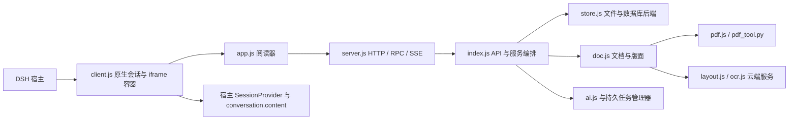

# 架构与阅读入口

维护基线：2026-11-20。这里保存稳定的模块关系和读代码路径；具体版本、默认值、API 和测试命令以当前源码及 [package.json](../../package.json) 为准。维护规则见 [协作资料入口](../README.md)，当前未验事项见 [项目状态](project-state.md)。

## 执行边界

本项目是零新增 npm 依赖、零构建步骤的 DSH 插件。宿主加载 [服务端入口](../../lib/index.js) 和 [客户端动态模块](../../lib/client.js)，阅读器是 [原生浏览器 SPA](../../assets/app/app.js)。Node 负责服务、任务与存储，Python + PyMuPDF [协处理器](../../assets/pdf_tool.py) 负责 PDF 提取、页图、裁剪与中文 PDF 写回。

DSH 外层路由先做宿主连接认证，独立开发服务器只复用插件 HTTP handler，不具备等价的宿主会话与认证验收条件。

## 主链与源码

| 主链 | 入口与协作模块 | 应同时核对的内容 |
| --- | --- | --- |
| 插件挂载与路由 | [index.js](../../lib/index.js)、[server.js](../../lib/server.js)、[sse.js](../../lib/sse.js) | 服务注入、认证先于 body、Host/Origin、静态路径与 SSE 断连语义 |
| 论文入库 | [index.js](../../lib/index.js) 的 `importOne/createApi`、[store.js](../../lib/store.js)、[pdf.js](../../lib/pdf.js) | link/copy、上传头校验、路径/内容/arXiv/DOI 查重、临时文件清理 |
| 文档构建 | [doc.js](../../lib/doc.js)、[layout.js](../../lib/layout.js)、[layout-ir.js](../../lib/layout-ir.js) | published layout 优先、PDF 文本/OCR 降级、缓存失效、目录和页身份 |
| 版面证据 | [layout-archive.js](../../lib/layout-archive.js)、[layout-table.js](../../lib/layout-table.js)、[figures.js](../../lib/figures.js) | raw/revision/current、行账、多源候选、表格网格、图注及裁剪缓存 |
| 翻译 | [ai.js](../../lib/ai.js)、[translate-jobs.js](../../lib/translate-jobs.js) | 同节分批、FIFO 派发、限流退避、增量落盘、订阅与任务控制分离 |
| 中文 PDF | [zhpdf.js](../../lib/zhpdf.js)、[zhpdf-jobs.js](../../lib/zhpdf-jobs.js)、[PDF 协处理器](../../assets/pdf_tool.py) | 补译所有权、源/文档/译文指纹、完整写回、暂存发布与失败回滚 |
| 原生对话 | [client.js](../../lib/client.js)、[conv.js](../../lib/conv.js)、[session.js](../../lib/session.js)、[paper-context.js](../../lib/paper-context.js) | 一对一 session、retain/release、作用域注入、异步代次和上传回执归属 |
| 阅读与标注 | [app.js](../../assets/app/app.js)、[style.css](../../assets/app/style.css) | 原文/译文选区、TeX 保留、富标注锚点、透明 PDF 文字层、裁剪附件 |
| 讲解与沉淀 | [explain.js](../../lib/explain.js)、[tools.js](../../lib/tools.js)、[workspace-skills.js](../../lib/workspace-skills.js)、[obsidian.js](../../lib/obsidian.js) | 焦点/全文预算、图表证据、结构化笔记、受管 marker 与无损卡片更新 |
| 检索与网络 | [arxiv.js](../../lib/arxiv.js)、[net.js](../../lib/net.js)、[history.js](../../lib/history.js) | 游标分页、部分失败、超时取消、代理、最小浏览历史和结果不落盘 |
| 数据与检查 | [db.js](../../lib/db.js)、[db-backend.js](../../lib/db-backend.js)、[db-pg.js](../../lib/db-pg.js)、[db-mysql.js](../../lib/db-mysql.js)、[review.js](../../lib/review.js)、[jobs.js](../../lib/jobs.js) | SQLite/JSON/外部库同契约、迁移、自检降级、日志异常不阻断主流程 |

## 身份与状态

- `paperId` 是文献库身份。`c-*` 是工作台对话，保存权威宿主 `sessionId`；新会话通常为 `pb-conv-*`，旧会话 ID 继续兼容。切换论文不会自动切换对话。
- 阅读定位包含 paper/page/section/block/revision；它只在对话关联论文内生效。`paper-context` 在目标 Agent 的系统提示组装阶段核对 `assembly?.scope === agent`，材料使用 `interpolate: false`。
- 段落/标题的 16 位内容 hash 是译文键；页码与顺序不是段落 hash 的组成部分。`blockId` 与版面 revision 用于空间和版本定位，不能与译文键混用。
- 文档缓存检查源文件、目录、解析 build、版面 revision 和标注锚点版本。原文摘录及目标均唯一时才自动迁移标注，其余进入 `annotationReview`；不模糊搬迁旧译文。
- 普通持久翻译的 SSE 连接只是观察者，断开不取消后台任务；显式暂停才 abort。重启后普通翻译由 running 变 paused，中文 PDF 的 running 任务有自己的恢复路径。

## 持久化分工

[store.js](../../lib/store.js) 管理配置、索引、每篇元信息、文档、对话和 UI 等文件；[统一数据库后端](../../lib/db-backend.js) 管理译文、任务事件、自检、富标注和研读笔记。默认 SQLite，缺少 `node:sqlite` 时使用同契约 JSON，另有零 npm 驱动依赖的 PostgreSQL/MySQL 实现。

`DSH_PAPER_WORKBENCH_DATA` 在模块求值时确定数据根，必须在 import 前设置。文件保留原子写及跨模块重载共享队列；并发译文用 `mergeTrans` 增量合并。版面 raw 不可变归档，派生版本先保存证据再切 current 指针。Obsidian 按整张卡片串行读改写，保留未受管内容并写前备份。

## 契约与验证入口

- 文档与翻译：[v2](../../docs/v2-contracts.md)、[v3](../../docs/v3-contracts.md)。
- 版面与质量：[v4](../../docs/v4-layout.md)、[v7](../../docs/v7-quality.md)、[评测说明](../../docs/quality/README.md)。
- 中文 PDF：[v6](../../docs/v6-zhpdf.md)；原生会话：[v8](../../docs/v8-native-session.md)。
- 测试映射和隔离命令以根 [AGENTS.md](../../AGENTS.md) 为入口；安装及 CI/CD 看 [发布运维](../operations/release-and-distribution.md)。

契约中的历史机器路径和验收快照不代表当前环境。版面行守恒不等于字符、表格或公式质量已经通过人工评测；原生组件夹具通过也不等于当前 Desktop 真机接入通过。
